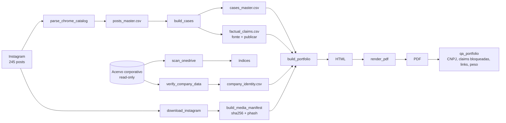

# Engvoltaica Portfolio — pipeline de portfólio comercial rastreável

> **Summary in English.** A Python pipeline that turns the scattered evidence of a solar-energy company (Instagram
> posts, ~30k files in a corporate cloud drive, the website and a previous PDF) into a **traceable commercial
> portfolio**: every number in the final PDF must exist in a `factual_claims.csv` with its source and a
> publish/block flag, every media file gets a SHA-256 manifest, and a QA script checks the rendered PDF (company
> ID, blocked claims, broken links, size for WhatsApp). Built by Emmily Maciel for her own company, Engvoltaica;
> this public copy has no company data, client names or media — only code, docs and fictitious examples.

## Problema

A empresa tinha seis anos de obras, mas a prova estava espalhada e era contraditória: o mesmo desconto aparecia
como 20%, 25% e 30% em materiais diferentes, o CNPJ circulava com um dígito errado e o link da bio do Instagram
estava quebrado. O portfólio anterior era um PDF bom, mas sem rastro de onde cada número vinha.

## Solução

Um pipeline em que o PDF é **saída**, não fonte:

1. `parse_chrome_catalog.py` — transforma uma auditoria dos 245 posts em `posts_master.csv` (extratores de potência,
   módulos, geração, economia, promessa de rendimento; ausência nunca vira zero).
2. `build_cases.py` — consolida projetos/usinas em `cases_master.csv` e cataloga cada afirmação em
   `factual_claims.csv` com `fonte_tipo`, `fonte_ref` e `publicar ∈ {SIM, SIM_COM_FRAMING, NAO}`.
3. `verify_company_data.py` — confere dados cadastrais abrindo os documentos oficiais (PDF), não a memória.
4. `scan_onedrive.py` / `copy_onedrive_originals.py` — indexam o acervo corporativo **somente leitura**, pulando
   arquivos só-na-nuvem (de 20+ min para 58 s).
5. `download_instagram.py` + `build_media_manifest.py` — download incremental com gallery-dl (sessão lida do
   navegador, cookie nunca vai para disco), manifesto com SHA-256 e hash perceptual de duplicatas.
6. `build_portfolio.py` → `render_pdf.py` (Edge headless) → `qa_portfolio.py`.

## Arquitetura



Decisões registradas em [`docs/DECISIONS.md`](docs/DECISIONS.md) (ex.: acervo é read-only, `data/raw` imutável,
nenhum número sem fonte, "outra IA não é fonte", cookies nunca no disco, sem commit automático).

## Números (projeto privado — fonte: `STATE.md`)

| Indicador | Valor |
|---|---|
| Posts catalogados | 245 |
| Afirmações factuais rastreadas | 28 (1 bloqueada por ser promessa de rendimento) |
| Arquivos indexados no acervo | 31.067 |
| Portfólio V2 | 9 páginas · 6,92 MB · QA 0 erros |
| Testes | 28 passaram, 5 pulados |

## Como rodar

```bash
python -m venv .venv
.venv\Scripts\python.exe -m pip install -r requirements.txt
.venv\Scripts\python.exe -m pytest tests -q
```

Nesta cópia não há dados: os testes de parsing, regras e segurança rodam; os que dependem de
`data/processed/`, do PDF ou das mídias são pulados (`skipif`). `examples/` mostra o formato das tabelas com linhas
fictícias. Os scripts de acervo leem `ENGV_ONEDRIVE_DIR`; o download do Instagram exige o navegador fechado.
README de trabalho original (sanitizado): [`docs/README-original-sanitizado.md`](docs/README-original-sanitizado.md).

## O que eu decidi × o que a IA gerou

| Eu (Emmily) decidi | Gerado com apoio de IA (Claude Code), sob minha revisão |
|---|---|
| Que nenhum número vai ao PDF sem linha em `factual_claims.csv` com fonte, e que promessa de rendimento é bloqueada | Extratores regex, consolidação de cases, montagem do HTML |
| Que o acervo corporativo e o portfólio V1 são somente leitura e `data/raw` é imutável | Varredura que pula arquivos só-na-nuvem, manifesto com hashes |
| Que cookies nunca tocam o disco (sessão lida do navegador) | Wrapper do gallery-dl incremental e retomável |
| O que o QA deve barrar (CNPJ, percentuais antigos, link quebrado, peso para WhatsApp) | `qa_portfolio.py` e os testes |

Base: `docs/DECISIONS.md` e `STATE.md`. A divisão fina por arquivo não foi registrada.

## Limitações

- Nesta cópia não há dados, mídias nem PDF: 25 dos 33 testes são pulados (`skipif`); só parsing, regras e segurança rodam. Os números da seção acima vêm do projeto privado.
- Os scripts de acervo dependem de uma pasta local sincronizada (`ENGV_ONEDRIVE_DIR`); o download do Instagram usa a sessão do navegador e exige o navegador fechado.
- A renderização do PDF exige o Microsoft Edge instalado (modo headless).
- Documentos de apoio citados em `CLAUDE.md`/`docs/` (qualidade de dados, fontes, evidências cadastrais) não acompanham esta cópia — ver [`SANITIZACAO.md`](SANITIZACAO.md).

## Stack

Python 3.12 · gallery-dl · Pillow · imagehash · PyMuPDF · pytest · Microsoft Edge headless (PDF)

## Verificação, sanitização e licença

- **Testes:** `py -3.12 -m pytest tests -q -p no:cacheprovider` → **8 passed, 25 skipped** (sem `data/processed`, PDF ou mídias nesta cópia) em 19/11/2026.
- **Dados:** valores ilustrativos e clientes anônimos (Cliente A…G); sem mídia nem dados da empresa.
- **Sanitização:** o que foi removido, trocado ou inventado nesta cópia está em [`SANITIZACAO.md`](SANITIZACAO.md).
- **Licença:** todos os direitos reservados; leitura permitida para avaliação de portfólio — ver [`LICENSE`](LICENSE) e [`NOTICE`](NOTICE).

## Aviso

*Dados fictícios. Versão sanitizada de um sistema em uso real; identificadores de clientes foram substituídos.*
Nomes de clientes viraram "Cliente A…G"; CNPJ, registro CREA, endereço e telefone são fictícios; não há mídia nem
dados da empresa nesta cópia.

Autora: **Emmily Maciel** — [github.com/Emmilymaciell](https://github.com/Emmilymaciell)
